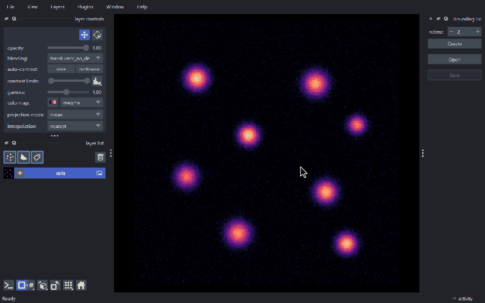
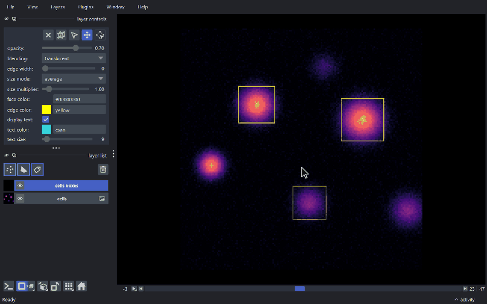

# napari-bbox

[](https://github.com/bauerdavid/napari-bbox/raw/main/LICENSE)
[](https://pypi.org/project/napari-bbox)
[](https://python.org)
[](https://github.com/bauerdavid/napari-bbox/actions)
[](https://codecov.io/gh/bauerdavid/napari-bbox)
[](https://napari-hub.org/plugins/napari-bbox)

A new layer for bounding boxes in 2+ dimensions

> **Note**: This plugin was originally part of [Annotation Toolbox](https://www.napari-hub.org/plugins/napari-nD-annotator), and was separated to allow other plugins to utilize it.

----------------------------------

## Features

- **A bounding box layer for napari** (`BoundingBoxLayer`) for axis-aligned boxes in
  2D, 3D and higher dimensional data.
- **Interactive editing in 2D**: draw, select, move and resize boxes.
- **Interactive editing in 3D views**: select, move and resize existing boxes
  while the viewer is in 3D mode, see [Editing in 3D](#editing-in-3d).
- **Undo and redo** of box edits, in 2D and in 3D, see [Undo and redo](#undo-and-redo).
- **Features and text labels**: attach a features table to the boxes and display
  it as text, like in the napari points and shapes layers.
- **Appearance**: edge color, edge width, face color, opacity and blending, set
  from the layer controls, plus a z-index per box to control which box is drawn
  on top.
- **CSV import and export**, and a *Bounding Box Creator* widget to create, open
  and save layers, see [Reading and saving](#reading-and-saving).
- Works with the standard layer actions of napari, such as **Duplicate Layer**.
- Supports **napari 0.4.15 up to 0.10** and is tested against them on every change,
  see [Compatibility](#compatibility).

## Demo

### Drawing and editing boxes in 2D

<!-- demo:2d-editing -->

<!-- /demo:2d-editing -->

### Editing boxes in 3D

<!-- demo:3d-editing -->

<!-- /demo:3d-editing -->

This [napari] plugin was generated with [Cookiecutter] using [@napari]'s [cookiecutter-napari-plugin] template.

<!--
Don't miss the full getting started guide to set up your new package:
https://github.com/napari/cookiecutter-napari-plugin#getting-started

and review the napari docs for plugin developers:
https://napari.org/stable/plugins/index.html
-->

## Usage

Create a layer from code with `viewer.add_bounding_boxes`, or with the *Bounding
Box Creator* widget from the `Plugins` menu:

```python
import napari
import numpy as np
import napari_bbox  # adds viewer.add_bounding_boxes

viewer = napari.Viewer()
viewer.add_image(np.random.rand(60, 200, 200))

# every box is given by two opposite corners
boxes = [
    np.array([[10, 20, 20], [40, 90, 100]]),
    np.array([[20, 100, 90], [55, 180, 170]]),
]
layer = viewer.add_bounding_boxes(
    boxes,
    edge_color="yellow",
    features={"label": [1, 2]},
    text="{label}",
)
```

`viewer.add_bounding_boxes(ndim=3)` creates an empty layer to draw boxes into, and
`from napari_bbox import BoundingBoxLayer` gives direct access to the layer class.
`layer.data` holds all `2 ** ndim` corners of every box.

### Interacting with the boxes

The layer controls have one button per mode. A mode can also be activated with
the keyboard while the bounding box layer is active.

| Mode | Key | What it does |
| --- | --- | --- |
| Select | <kbd>2</kbd> | Select, move and resize boxes. Hold <kbd>Shift</kbd> while resizing to keep the aspect ratio. |
| Pan/zoom | <kbd>3</kbd> | Move the camera as usual. |
| Add bounding boxes | <kbd>4</kbd> | Draw new boxes (2D views only). |

Hold <kbd>Space</kbd> to temporarily switch to pan/zoom in any mode (rotate and
pan in 3D), and release it to go back to the previous mode. Selected boxes are
deleted with the delete button of the layer controls or with the
<kbd>Delete</kbd> key.

### Editing in 3D

Existing boxes can be edited while the viewer is in 3D mode (add mode is only
available in 2D). In select mode:

- **Click** a box to select it. <kbd>Shift</kbd>-click or <kbd>Ctrl</kbd>-click
  adds the box to the selection or removes it from there.
- **Drag** a selected box to move all selected boxes in the plane parallel to the
  screen.
- **Drag a face handle** of a single selected box to move that face along its
  axis, which resizes the box. The handle stays under the cursor, also in oblique
  views. Handles facing the camera are hidden.
- **Drag on empty space** to draw a selection box. Boxes whose center is inside
  it get selected.
- Pressing <kbd>Space</kbd> during a drag hands the rest of the drag over to the
  camera, so the view can be rotated in the middle of an edit.

### Undo and redo

Edits of the bounding boxes in the active bounding box layer can be undone with
<kbd>Ctrl</kbd>+<kbd>Z</kbd> and redone with <kbd>Ctrl</kbd>+<kbd>Shift</kbd>+<kbd>Z</kbd>
(or <kbd>Ctrl</kbd>+<kbd>Y</kbd>), in 2D and in 3D. Adding, moving, resizing,
deleting and pasting boxes are one undo step each, a mouse drag is one step.
Selecting boxes is not.

From code, use `layer.undo()`, `layer.redo()`, `layer.can_undo`, `layer.can_redo`
and `layer.clear_history()`. Undo and redo restore the corners, features, colors,
edge widths and z-indices of all the boxes and emit the same `layer.events.data`
events as the edit they are equal to. The last 50 edits are kept.

Setting `layer.data` or `layer.features` from code is not an edit, it is not
recorded. If it changes the layer the history is cleared, so undo cannot bring
back boxes from before the change. Adding boxes with `layer.add` and deleting
them with `layer.remove_selected` are edits.

### Reading and saving

Bounding boxes are stored in CSV files with one box per row: the minimum
corner followed by the maximum corner, i.e. `min_0, ..., min_n, max_0, ..., max_n`
for boxes in `n` dimensions.

- `napari-bbox` registers a reader for `.csv` files, so they can be opened with
  `File > Open`.
- The *Bounding Box Creator* widget has buttons to create, open and save layers.
- From code, `napari_bbox.write_single_bbox(path, layer.data, {})` saves a layer.

## Installation

You can install `napari-bbox` via [pip]:

    pip install napari-bbox


To install latest development version :

    pip install git+https://github.com/bauerdavid/napari-bbox.git

## Compatibility

`napari-bbox` supports **Python 3.9 and newer** and **napari 0.4.15 and newer**.

### Supported napari versions

| napari | Python | Undo/redo and 3D editing | Tested in CI |
| --- | --- | :---: | --- |
| 0.4.15 – 0.4.17 | 3.9+ | no | 0.4.15, 0.4.17 |
| 0.4.18 – 0.4.19 | 3.9+ | yes | 0.4.18, 0.4.19 |
| 0.5.x | 3.9+ | yes | 0.5.0, 0.5.6 |
| 0.6.x – 0.7.x | 3.10+ | yes | 0.6.0, 0.6.6, 0.7.1 |
| 0.8.x – 0.10.x | 3.11+ | yes | 0.10.0 |

The Python versions are the ones napari itself requires. napari 0.10 also
requires Qt6.

### Testing

- The test suite runs in CI on every push and pull request, against the napari
  versions in the last column. `napari-bbox` has a separate implementation for
  each range of napari versions, and these are the oldest and newest releases
  of each of them.
- The tests run on Linux. Windows and macOS are not covered by CI.
- Other releases within the ranges above, such as 0.4.16, 0.5.3 or 0.9.2, are
  not tested separately.

## Changelog

### 0.2.0

**Added**

- [Editing of existing bounding boxes in 3D views](#editing-in-3d): select, move
  and resize boxes with face handles, and box selection.
- [Undo and redo](#undo-and-redo) of box edits.
- Support for napari 0.10.
- A CI test suite that runs against napari 0.4.15 up to 0.10.

**Changed**

- In a layer with a scale, the thickness of the edges (`edge_width`) and the size
  of new boxes along the dimensions that are not displayed (average mode and the
  size constant) are in world units, so they do not depend on the scale.
  Layers without a scale are not affected.

**Fixed**

- *Duplicate Layer* raised an error on napari 0.5 and newer.
- Removing the last bounding box left it displayed.
- Clearing a layer raised an error on napari 0.4.15 with vispy 0.12 or newer.
- The opacity and blending rows of the layer controls were shown twice on napari
  0.6 and newer, and a new layer had an opacity of 0 on napari 0.6.0.
- Boxes drawn in a layer with a scale were stretched along the scaled axes in the
  dimensions that are not displayed.
- The edges of the boxes were stretched along the scaled axes in layers with a
  scale, e.g. the 3D tubes became flat ribbons.

## Contributing

Contributions are very welcome. Tests can be run with [tox] or with `pytest`,
please ensure the coverage at least stays the same before you submit a pull request.

The demo GIFs of this page are generated with
[napari-demo-recorder](https://github.com/bauerdavid/napari-demo-recorder) from the
files in [`docs/demos`](https://github.com/bauerdavid/napari-bbox/tree/main/docs/demos). After changing the user interface, render them again with

    pip install git+https://github.com/bauerdavid/napari-demo-recorder.git
    napari-demo-recorder render docs/demos/*.demo.yaml

## License

Distributed under the terms of the [BSD-3] license,
"napari-bbox" is free and open source software

## Issues

If you encounter any problems, please [file an issue] along with a detailed description.


[napari]: https://github.com/napari/napari
[Cookiecutter]: https://github.com/audreyr/cookiecutter
[@napari]: https://github.com/napari
[MIT]: http://opensource.org/licenses/MIT
[BSD-3]: http://opensource.org/licenses/BSD-3-Clause
[GNU GPL v3.0]: http://www.gnu.org/licenses/gpl-3.0.txt
[GNU LGPL v3.0]: http://www.gnu.org/licenses/lgpl-3.0.txt
[Apache Software License 2.0]: http://www.apache.org/licenses/LICENSE-2.0
[Mozilla Public License 2.0]: https://www.mozilla.org/media/MPL/2.0/index.txt
[cookiecutter-napari-plugin]: https://github.com/napari/cookiecutter-napari-plugin

[file an issue]: https://github.com/bauerdavid/napari-bbox/issues

[napari]: https://github.com/napari/napari
[tox]: https://tox.readthedocs.io/en/latest/
[pip]: https://pypi.org/project/pip/
[PyPI]: https://pypi.org/
